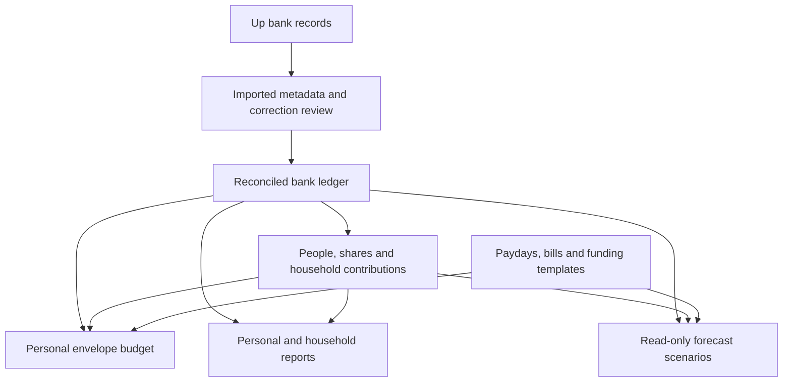

# FlyBudget: Australian budgeting and shared expenses investigation

20 October 2026 · Investigation with implementation notes for phases one to three

Source reviewed: `tvrooi/FlyBudget` at `f952208ad41c3d65643aeb826f4256220df6672b` (`v0.2.0-up.4`). This investigation used source code, synthetic examples and public documentation. The original investigation did not inspect or change the live budget, bank connection or Home Assistant installation. A later user-authorised read-only UI check is described in the phase-one notes below. Examples of percentages and account balances are illustrative.

The recommended direction is to retain the existing monthly envelope budget and add payday funding, shared-expense attribution and a separate forecasting layer. Bank statements must continue to reconcile exactly. A different display or report must not rewrite a real bank payment.

## Findings at a glance

| Request                  | What exists now                                                           | Recommended amendment                                                                 | Scope                                                             |
| ------------------------ | ------------------------------------------------------------------------- | ------------------------------------------------------------------------------------- | ----------------------------------------------------------------- |
| Daily round-ups          | Settled Up imports; round-up metadata is discarded                        | Verify import accounting, then a collapsible daily transfer summary                   | Medium, with an accounting investigation first                    |
| Merchant photographs     | Custom payee image uploads and register display                           | Use existing images; optional reviewed logo lookup later                              | Small manually; automatic Up images unavailable in documented API |
| Fortnightly salaries     | Every-two-weeks schedules; monthly allocations with rollover              | Payday funding plan using actual dates, due bills and cash received                   | Medium to large                                                   |
| Superannuation           | Off-budget Retirement account, value adjustments and net worth            | Australian labels, valuation dates and liquid/retirement views                        | Small basic; medium for contribution tracking                     |
| Useful additions         | Rules, splits, recurring discovery, reports, goals and undo already exist | Better sync review, bill coverage, funding templates, tags and durable change history | Several independent amendments                                    |
| 2Up and Essentials       | Joint accounts can be selected; no ownership/share model                  | Personal and household report scopes, contribution ledger and bill coverage           | Large                                                             |
| Tricount-style splitting | Category splits, without people or debts                                  | Groups, people, shares, payments and settlement allocations                           | Large; shares the 2Up foundation                                  |
| UI                       | Existing modern responsive interface                                      | Progressive disclosure, clear scopes and a focused review inbox                       | Small to medium per screen                                        |
| Savings projection       | Goal progress and monthly amount needed; historical reports               | Read-only scenarios with exact payday dates and editable assumptions                  | Medium after the accounting foundation                            |

These scope labels describe relative complexity, not delivery estimates.

## 1. Round-ups: group the display while keeping the bank ledger

Up's linked article describes round-ups moving purchase change into a nominated saver. It dates from 2019, so its original nearest-dollar examples should not be treated as the complete current rule set. [Up: The Round Ups Round-up](https://up.com.au/blog/the-roundups-roundup/)

The current API documents `roundUp.amount` and `boostPortion`. The total includes boosts; the boost is a component, not an additional amount to add again. [Up API: transactions](https://developer.up.com.au/#transactions)

**Confirmed source findings:** `upTransactionSchema` does not retain round-up details. `upImportRows()` imports settled transactions only. Later imports skip any existing bank ID, preserving user edits. `syncUp()` recalculates the starting balance to match the bank-derived balance. Consequently, a matching current balance does not establish that all historical round-up movements are represented correctly.

**First investigation:** establish, using a minimal redacted example or disposable fixture, how Up represents the purchase debit, its round-up component and the saver credit. Determine whether there is a separate debit, whether destination relationships are present, how boosts/reversals appear, and what happens while a purchase is held. The public schema does not establish every posting relationship needed to safely invent missing transfer legs. This is a correctness question before it is a visual grouping question.

**Recommended interface:** one expandable row per bank-local day, source account and destination saver:

> Round-ups · 20 October · $3.42 saved · 8 purchases · Updated at last sync

Expansion shows each original purchase and linked movement. In an all-account view count the saving once, rather than adding the debit and credit together. Separate destinations and personal/joint accounts. A purchase can show a small “includes 40¢ round-up” detail without changing its merchant expense.

Daily totals should be recomputed from identified bank events, never incremented blindly at each sync. Attribute to purchase date by default, retain settlement date, and use the bank timestamp's offset rather than the HA host timezone. Late settlements can amend an earlier day's summary. Show “still updating” where known pending purchases exist; do not promise permanent finality at midnight or after an arbitrary number of days. The absence of a known hold does not guarantee there will be no later correction.

Round-ups between accounts inside the same budget are transfers, not extra shopping expenses or new income. Moving money into a saver also does not automatically give it a category assignment: assigning it to a savings envelope should be an explicit option. If the destination is outside the budget, apply the chosen budget-boundary policy. Do not generate a phantom saver credit merely to make a chart look complete.

The current preview refreshes on startup/manual sync. A changing summary needs background refresh. Begin with configurable polling, overlap/reconciliation and visible freshness. Webhooks can follow if lower latency is needed. They require signature verification, replay-safe processing and re-fetching the transaction; a notification alone is not a complete ledger entry. Keep bank-managed fields separate from user categories, notes and splits, and queue corrections affecting reconciled entries for review.

**Acceptance cases:** boosted/even-dollar round-ups, two destinations on one day, identical small amounts, repeated imports, settlement days later, refund/correction, DST/midnight, one account excluded, both transfer legs imported, and reconciled transactions. A historical backfill must show a preview and preserve existing edits; no automatic rewriting of opening balances to hide a discrepancy.

## 2. Merchant photographs and logos

FlyBudget already supports small custom payee images. The Payees screen and transaction row use `PayeeIcon`; selecting its editable image allows an upload, saved once per payee. Consolidating duplicate payees lets transactions reuse that image.

I found no merchant photograph/logo field or merchant image endpoint in Up's published transaction schema. Attachments are a separate resource and should not be treated as a merchant-logo feed. Exact image parity with the Up app is therefore unavailable through the documented personal API reviewed here. [Up: published OpenAPI specification](https://raw.githubusercontent.com/up-banking/api/master/v1/openapi.json)

**Recommendation:** use the existing upload feature immediately. Later add an optional logo search with a user-confirmed merchant match. Store the selected thumbnail so every device displays it consistently. A chain logo will not necessarily reproduce a particular shopfront photograph. Preserve manual overrides. External lookup should not send purchase amounts or full bank descriptions, and image retrieval needs the existing safe-fetch protections and size/type limits. Provider coverage, cost and image-use terms would need a separate evaluation before choosing a service.

## 3. Fortnightly pay: change funding, retain monthly accounting

Fortnightly pay is compatible with envelope budgeting. The missing convenience is funding categories on paydays rather than manually translating every goal into a monthly amount.

**Correction to the initial premise:** FlyBudget already has `biweekly` schedules, labelled “Every 2 Weeks”. YNAB documents using fortnightly income within a monthly plan, while its current target documentation says a dedicated biweekly target is unavailable. These are different capabilities: receiving income every 14 days, repeating a transaction, and calculating category funding per payday. [YNAB: pay cycles](https://support.ynab.com/en_us/how-to-adjust-your-plan-on-any-pay-cycle-HkpGZdW1o), [YNAB: target types](https://support.ynab.com/en_us/getting-started-with-targets-ryAEP08xC)

Add a **Payday plan** with an anchor payday, expected take-home pay, every-14-days recurrence, optional adjusted payment dates and several funding methods:

- **Until next payday:** fund essential spending and bills falling before the following payday.
- **Due-date saving:** divide the remaining bill/goal shortfall over the actual paydays remaining before its deadline.
- **Fixed per pay:** assign a fixed amount each payday.
- **Percentage/remainder:** assign a chosen share of received income or the remainder after higher-priority needs.
- **Smooth monthly costs:** spread annualised costs over the paydays, with an initial catch-up/buffer where necessary.

For example, a $1,200 monthly bill has an approximate 26-pay-year funding rate of `$1,200 × 12 ÷ 26 = $553.85` per fortnight. Two such contributions do not cover a $1,200 bill immediately: smoothing requires an existing buffer. The due-date method should identify any catch-up needed, rather than promising that averaging makes the next bill affordable.

Generate actual dates. A hypothetical cycle starting 1 October 2026 pays on 1, 15 and 29 October, then 12 November. Do not equate fortnightly with twice monthly or assume every calendar year always contains exactly 26 deposits; enumerate the relevant dates, including occasional 27-pay years and payment-date changes.

The monthly view can show the sum of confirmed payday allocations. An allocation is a movement between envelopes, not a new bank transaction. Expected future wages belong in the forecast and must not increase today's available money. Applying a plan should show a preview, cap funding to available cash, honour priorities, retain rollover and store an idempotent funding event so re-clicking does not allocate the same pay twice. A three-pay month should follow the selected funding rules, not automatically treat the third deposit as a bonus.

Reuse recurrence/occurrence generation, adding payday templates and an allocation-event history. Do not replace `budgetMonths` with a second independent fortnightly budget whose totals can diverge. Test month/year crossings, early/late pay, variable income, insufficient money, two employers, partial goal funding and reapplying an edited plan.

## 4. Superannuation

Keeping super off budget is the appropriate design for this use: it contributes to a wealth view without becoming money available for household spending. This is a recording recommendation, not a recommendation about investments or contribution amounts.

The existing Retirement type defaults off budget. “Update Value” creates an adjustment transaction which affects balance/net worth; an uncategorised adjustment is excluded from income/spending totals. Its present UI dates the adjustment today. The account hint currently names US products, so there is a straightforward Australian terminology improvement.

**Recommended basic workflow:** name the account for the fund, keep it off budget, and periodically enter the statement's balance. Store the **valuation date** separately from the entry date, show “last confirmed” and a statement/source note, and allow backdated corrections. Do not overwrite the original starting balance for each new statement. A balance rise alone should be called “balance change”, not investment return: it could include contributions, market movements, fees and insurance.

For more detail, add separate event types for employer/personal contributions, salary sacrifice, contribution tax, fees, insurance, rollovers and valuation movement. Net wage deposits should stay net wage deposits; employer contributions and salary sacrifice should not inflate spendable income. A personal payment from a budget account into super needs a funded outflow at the budget boundary while still preserving the actual account movement. Current transfers clear both categories, so that policy needs implementation and tests before promising automatic treatment.

Provide distinct figures for **liquid assets**, **super**, and **total net worth**, plus an Australian July–June reporting option. Employer amounts expected from payslips should remain expected until received in the fund. Support statement CSV import where a fund provides it; a universal super API is not assumed.

Fund statements are useful for checking received contributions, fees and insurance. [ASIC Moneysmart: checking super](https://moneysmart.gov.au/grow-your-super/how-to-check-your-super)

Do not hard-code an old quarterly employer-payment assumption. Current ATO guidance describes Payday Super operating from July 2026; a future reminder feature needs configurable expectations and current rules rather than embedding rates or deadlines in UI text. [ATO: Payday Super has started](https://community.ato.gov.au/s/article/a07Mo00001qD2iH/payday-super-has-started-heres-what-employers-need-to-know-and-do)

## 5. Useful ideas from Actual and Up

FlyBudget already has transaction rules, category splits, recurrence discovery, transfer suggestions, custom reports, goal progress and client undo/redo. Those should be extended rather than rebuilt.

The best additions for this application are:

1. **A bank review inbox:** new imports, pending activity, possible corrections, transfer matches and categorisation suggestions; last successful sync and actionable failures. Add polling before webhook complexity.
2. **Funding templates and bill coverage:** show what needs money by each payday and what is already covered. Actual's budget templates support recurrence, schedules and priorities, but are documented as experimental; borrow the concepts through clear controls rather than requiring note syntax. [Actual: budget templates](https://actualbudget.org/docs/experimental/goal-templates/)
3. **Personal/household report scopes and reimbursements:** preserve gross payments, distinguish the user's costs, and show unsettled balances. Actual's guides offer useful categorisation precedents, although they are not evidence of a built-in Tricount-style debt ledger. [Actual: joint accounts](https://actualbudget.org/docs/budgeting/joint-accounts/), [Actual: reimbursements](https://actualbudget.org/docs/budgeting/returns-and-reimbursements/)
4. **Optional Up category/tag mappings:** suggest local categories using explicit mappings and preserve manual decisions. Do not silently rename the user's budget or write changes back to Up. Local tags could mark a holiday, reimbursable purchase or household without multiplying budget categories.
5. **Durable review history:** record why an import changed and which funding/split operation was applied. Existing session undo is useful but is not a persistent server audit trail across devices.
6. **Projection scenarios:** reuse actual transactions and schedules, with clearly editable assumptions. Actual now documents an experimental Balance Forecast report based on schedules/history. [Actual: balance forecast](https://actualbudget.org/docs/experimental/balance-forecast-report/)

Up's Essentials is a particularly relevant reference: its current description ties recurring bills to paydays and sets money aside through Pay Splitting. That is a stronger model for this request than merely adding a frequency selector to a monthly target. [Up: Essentials](https://up.com.au/blog/essentials/)

## 6. 2Up, rent contributions and shared Essentials bills

Separate three concepts: a bank account's holders, the people contributing to a household, and each person's agreed expense share. Up describes 2Up as two account holders. A household's other contributors can still be tracked in FlyBudget; that does not make them additional bank holders. [Up: 2Up](https://up.com.au/2up/)

The API exposes joint ownership and may identify the customer performing a transaction; that does not establish who ultimately owes each share. No documented Essentials bill-definition/Regulars endpoint was found in the reviewed public specification. Account availability and categorisation must be checked against the actual account list before claiming complete Essentials coverage. Bill definitions can be entered locally, then matched to imported payments. [Up: published API specification](https://raw.githubusercontent.com/up-banking/api/master/v1/openapi.json)

**Recommended model:** preserve the complete joint-account register but label it as a household account and explicitly control personal budget availability, report scope and personal net-worth inclusion. A fixed ownership percentage on the entire balance is too crude where people contribute different amounts, prepay bills or settle at different times. Other people's prepaid funds must not appear available for personal discretionary spending.

For the $4,780 rent payment, a hypothetical 40% share gives:

| Measure                                   | Amount |
| ----------------------------------------- | -----: |
| Payment in bank register / household cost | $4,780 |
| Personal expense at illustrative 40%      | $1,912 |
| Other participants' shares                | $2,868 |

The percentage is an example, not an assumption about the actual agreement. Recording an agreed share does not determine liability under a lease.

If the user pays the full amount from personal money, the other $2,868 may be a reimbursement claim. If housemates already contributed their shares to the joint account, paying the rent must consume those advance credits, **not create another debt for the same amount**. Keep the joint account's whole balance for reconciliation; its personal attribution depends on contributions and obligations.

There should be separate **Bank movement**, **Household spending** and **My share** views. Salary is personal income; household contributions and repayments are distinct funding/settlement events. The personal view should not count both a contribution to the household and the underlying share of rent as separate expenses. The bank view should still show when cash actually left. Unpaid reimbursements are not spendable cash.

**Important current code limitation:** `CashFlow.tsx` builds the visible cash-flow page from category income/spending endpoints. Those endpoints do not consistently filter off-budget accounts, while `/cash-flow` and `/daily-flow` apply an on-budget filter. Net worth includes off-budget accounts at their full balances. Simply marking a joint account off budget will therefore not reliably solve either spending attribution or personal wealth attribution. This is a source-level finding, not a diagnosis of the live $4,780 total.

An interim manual approach is to categorise housemates' receipts back to the relevant expense category, rather than Salary. The current category-spending endpoint nets those flows, which may give a useful net cost when deposits and bills fall in the same report period. It does not provide a participant ledger, reliable cross-period shares or protection for other people's money. Review transfers explicitly and do not modify the real payment amount to the personal share.

**Essentials bills:** extend existing schedules with household group, paying account, total estimate, personal share, due date, actual billed amount, received contributions and allocated funds. Useful statuses are “funded”, “shortfall”, “due”, “paid” and “needs review”. A quarterly bill should accrue across paydays. Match an imported debit to its occurrence once; it must not coexist with a duplicate auto-created bill transaction. Account cash alone is not bill coverage: it may already be reserved for another bill. Importing a bank account does not automatically import Up's bill setup, and FlyBudget should not promise to initiate payments.

## 7. Tricount-style people and balances

Feasible, and best built on the same shared-expense system as section 6. Tricount documents uneven splitting, separate personal/group totals and repayment calculations. [Tricount FAQ](https://help.tricount.com/en/articles/tricount-faqs)

Add **Split with people** to a transaction, distinct from the existing “split between categories”. The detail panel should ask for a group, payer/funding source, participants, equal/percentage/weight/exact shares and an optional due date. For $120 paid personally with a 50/50 split, personal expense is $60 and the other participant owes $60. A later $30 repayment reduces that claim to $30 without becoming salary or a second expense reduction.

Support expenses paid by someone else without inventing a debit in the user's bank account. Distinguish advances into a household pool, direct payments, repayments and refunds. Allow one repayment to settle several claims and partial payments to settle part of a claim. Link bank imports to those events, retaining the bank ID. Do not add a fictitious receivable account on top of a receivable already included elsewhere in net worth.

Use integer cents, exact total validation and deterministic remainder distribution. For example, a three-way split of $100 is $33.34/$33.33/$33.33, with a visible way to change who receives the residual cent. Store agreed share amounts so later membership/percentage changes do not rewrite past expenses. Refunds reverse the original allocations; currency conversion needs a declared rate and separate handling of bank fees.

Start with a private ledger inside the user's budget, with group/person balances and an exportable statement. Giving friends access is a separate product change: today's shared server password does not isolate their household view from private transactions. Multi-user permissions, invitations and concurrent-edit handling must precede collaborative access. A native ledger does not require a Tricount integration; live two-way Tricount sync is outside this proposal because no supported public integration contract has been established.

## 8. UI amendments without a redesign

This is a source-based design review, not a usability study of the running app. Retain its visual language and introduce features through detail panels and focused views:

- Put a persistent **Personal / Household** scope beside report dates, reflected in the report title and export. Show both gross and personal amounts on a shared payment.
- On the budget, offer **Month / Until next payday**. Show expected payday separately from money received, bills due and funding shortfalls. A preview explains an allocation before it is applied.
- Collapse round-ups into expandable summaries. Keep original rows available for reconciliation and export.
- Provide a focused **Needs review** filter for imports, transfers, unknown shares and corrections. Existing icons and colours should support text status, not replace it.
- In transaction details, expose **Categories** and **People** as separate allocation controls. Show payer, group, shares and outstanding amount together.
- Add a compact bill timeline and a “who has contributed” view; keep advanced scenario settings out of routine transaction entry.
- Use “Fortnightly”, “Superannuation”, Australian date formatting and optional financial-year ranges where appropriate. Preserve clear currency labels and regional options for other users.
- Show last-sync/last-valuation times. Support keyboard navigation, screen-reader labels and comfortable mobile touch controls for all new features.

Existing responsive reports, editable payee images and undo should be reused. No blanket visual refresh is justified by this investigation.

## 9. Future savings and custom scenarios

Yes. The current Goals page shows progress and a required monthly pace, but I found no general future-savings/scenario engine in the reviewed paths. Linking an account to a goal currently labels the goal; it does not automatically derive its stored `currentAmount` from that account balance.

Build a read-only **Forecast** view with two connected outputs:

1. **Cash runway:** a day-by-day balance using actual account balances, scheduled net wages and bills, and explicit discretionary-spending assumptions. Highlight the lowest balance before payday.
2. **Goal trajectory:** current funded savings, contributions on real paydays, planned withdrawals and optional growth assumptions. Show a target line and estimated attainment date.

Offer “current pattern”, “planned contributions” and “custom scenario”. Start with zero assumed investment growth. Users can change per-pay saving, start/end dates, one-off expenses, income changes and explicitly labelled returns/fees/inflation. A longer-term super scenario must keep restricted retirement wealth separate from accessible savings.

For a simple period model, `next balance = prior balance × (1 + period return) + contributions − withdrawals`. Actual application calculations should apply contributions on their dates and state the compounding convention. Cash forecasts need no return assumption. Inflation-adjusted values must be labelled separately from nominal dollars.

Custom formula examples could be `min(available_surplus, 20% of net_pay)` or “save $300 on each payday after essentials are funded”. Provide a controlled formula builder or constrained expression language; no arbitrary JavaScript or access to credentials. Define missing inputs, negative surplus, rounding and evaluation order, with a visible sample calculation. Saved scenarios must never create transactions or allocate real money unless a separate explicit action is chosen.

Historical estimates should exclude transfers, uncategorised balance adjustments and one-off reimbursements, use personal shares where applicable, and avoid counting scheduled bills again in the variable-spending average. A payment matched to an occurrence replaces its forecast event. Use category-funded savings or explicitly allocated portions of an account so two goals cannot each claim the same entire balance.

Display actual history as a solid line, future assumptions as dashed lines, and compare labelled base/conservative/stretch scenarios. These are scenarios, not statistical confidence intervals. Show start date, horizon, account scope, data freshness and the assumptions behind the result. A table and CSV should accompany the chart. YNAB's documented loan simulator is a useful interaction reference; I have not established that its exact feature is a general savings projection. [YNAB: loan payoff simulator](https://www.ynab.com/blog/ynab-loan-planner)

## Architecture and implementation order

Proposed entities are bank-source metadata/corrections, household groups and participants, expense allocations, contributions, settlement allocations, funding templates/events, valuation records and forecast scenarios. These are design candidates, not a migration specification. Keep them additive, exportable and covered by backup/restore. Preserve bank IDs and reconciled records. Avoid placing sensitive source payloads in logs or fixtures; retain only needed metadata.

| Order               | Deliverable                                                                            | Minimum evidence before release                                                                                     |
| ------------------- | -------------------------------------------------------------------------------------- | ------------------------------------------------------------------------------------------------------------------- |
| 1                   | Verify round-up accounting; unify report account scopes and budget-boundary policy     | Paired debit/credit fixtures, repeat-sync tests, starting-balance reconciliation, off-budget/report consistency     |
| 2                   | Background sync/review and daily round-up presentation                                 | Late settlement/correction, no double count, clear freshness, expanded original records                             |
| 3                   | Payday plan and bill coverage                                                          | Actual date enumeration, catch-up funding, insufficient funds, no duplicate allocations or scheduled salary/bills   |
| 4                   | Household/person ledger, shared bills and personal-share reports                       | Prepaid vs reimbursable examples, partial settlement, refunds, own/others' balances and no spendable receivables    |
| 5                   | Savings forecast using the same paydays, bills and shares                              | Deterministic scenario fixtures; no writes; no duplicate goals, transfers or planned/actual payments                |
| 6                   | YNAB envelope correctness, credit funding, category goals, targets, buffers and review | Shared funding invariant; opening/future funds, rollover, deficits, card reserves, atomic moves and backup coverage |
| Parallel small work | Super terminology/valuation-date workflow and existing-logo guidance                   | Historical valuation preserved; no spendable super; manual logo remains authoritative                               |

Each deliverable should be a focused pull request with a short acceptance example and relevant tests. Feature flags or opt-in setup should keep existing budgets stable. Complete a tested backup/restore before any live data migration; there is no live migration or release in this investigation.

## Phase one: accounting foundation (20 October 2026)

### Evidence and round-up limits

Rechecked the [published Up OpenAPI specification](https://raw.githubusercontent.com/up-banking/api/master/v1/openapi.json). `RoundUpObject.amount` is a signed negative total including its boost; `boostPortion` is a component. The published transaction example has a purchase amount and round-up amount but a null `transferAccount`. That example does not establish a source/deposit journal pair or how holds and reversals affect every posting.

At the user's request, inspected the running remote FlyBudget UI read-only. The inspected imported round-up entries were positive, uncategorised saver credits. One detail panel contained the importer's internal-transfer review note; the current-month payee search showed saver-side entries. This confirms separate credits in the imported register. It does **not** prove the raw purchase posting shape, identify a counterpart by amount/date alone, or prove that a debit under another description is absent. The deployed importer discarded purchase round-up metadata, so the register cannot recover that evidence. No records, connection settings or Home Assistant configuration were changed; no live data, screenshots, identifiers, account names, amounts, credentials or deployment address were copied into this repository.

The parser now validates and retains optional round-up metadata **in memory during parsing**. Import mapping leaves the purchase amount and existing bank IDs unchanged, does not add the boost again, and does not manufacture a transfer leg from that metadata. This phase adds no metadata table or automatic historical backfill. Synthetic fixtures cover an explicitly supplied debit/credit pair, boost totals, an even-dollar boost, zero round-up, held purchases, a late settlement over the DST boundary, repeat imports and reconciled/user-edited records. An explicit paired fixture demonstrates importer behaviour, not proof that Up always uses that posting shape.

Sync now establishes a starting balance only when the local register is empty. Once it has history, a difference between the bank-derived settled balance and the register produces a review error while preserving the opening balance and all existing rows. New bank IDs still import; existing IDs remain untouched. The initial derived opening balance remains a bootstrap assumption, **not** evidence of complete historical accounting. An empty register (including one whose entire history was deliberately deleted) still bootstraps; a persistent per-account initialization/review state belongs with the later sync-review work.

**Still unresolved:** source debits represented only by purchase metadata, safe linking to saver credits, boosts/reversals in actual bank payloads, round-up effects while held, and corrections to previously imported IDs. A minimal read-only inspection of the bank-source fields is still needed before implementing missing legs or daily grouping. Do not guess from merchant descriptions or equal small amounts, and do not rewrite existing records/opening balances to conceal the discrepancy. The code deliberately exposes a mismatch on subsequent syncs; it does not repair old round-ups.

### Report account scope

All default income/spending endpoints now use on-budget accounts: category spending, category income, income versus expenses, cash flow, daily flow, trends, comparison and default custom reports. Cash Flow and calendar drill-downs request the same activity scope. Splits count through their children in aggregates and appear once with their children in the register. Uncategorised balance adjustments are excluded; categorised adjustments retain their existing explicit treatment. Closing an account does not remove its historical spending from these reports.

Custom reports with explicit account IDs still support off-budget analysis. Their account selection does not redefine the envelope budget's boundary. Net worth deliberately remains a whole-wealth report with full off-budget balances and its existing closed-account policy. None of these scopes provides personal/household attribution or ownership shares.

### Budget-boundary policy

| Confirmed movement                    | Budget and default activity reports    | Category handling                                                                |
| ------------------------------------- | -------------------------------------- | -------------------------------------------------------------------------------- |
| On budget → on budget                 | Exclude both legs from income/spending | Preserve stored categories; do not allocate envelopes automatically              |
| On budget → off budget                | Count only the on-budget outflow       | Retain its category; allow the user to choose the funded expense category        |
| Off budget → on budget                | Count only the on-budget receipt       | User chooses income, or the original expense category for a return/refund        |
| Off budget → off budget               | Exclude both legs from budget activity | Preserve stored categories; balances/net worth still follow the actual movements |
| Destination not imported or not known | Keep the original unlinked transaction | No inferred transfer, counterpart or household share                             |

For a synthetic $100 personal contribution to an off-budget retirement account, the bank legs remain −$100/+ $100 and only the budget outflow consumes the chosen contribution category. A $20 return in that same category reduces its net cost to $80. A receipt deliberately assigned to an income category increases income/to-be-budgeted. Uncategorised receipts keep the existing report convention (net activity outside income categories); users must review and categorise them rather than having the app infer salary or reimbursement. An uncategorised outflow is visible for review but does not choose or fund an envelope automatically.

The same predicate applies to monthly category activity, rollover, category history and budget income summaries. Explicit linking preserves categories, bank IDs, amounts and notes; it still uses the existing transfer display name and retains bank payee text. Boundary classification is computed from current account settings, including for existing links; there is no transaction migration. Changing an account's budget status changes its historical report scope. Previously cleared categories are not reconstructed. Reconciled rows remain locked; editing/deleting an unreconciled leg cannot alter a reconciled counterpart. Transfers require user confirmation through the existing suggestion/link workflow.

### Verification

Focused API tests exercise boundary outflows and returns, off-budget income/spending, internal and wholly off-budget transfers, split totals, adjustments, custom account selection, report drill-downs, rollover and preservation of original rows. Up tests use only the local mock server and disposable in-memory databases. Local checks passed: 75 focused server tests (accounting, reports, transfers, Up, adjustments and currencies), 206 client tests, five desktop browser tests (Up connection/resync and transfer categorisation), client production build, server/browser-adapter/e2e type checks and Prettier on changed files. No live deployment, budget migration or release is part of this change.

## Remaining evidence needed before implementation

1. Minimal redacted round-up event shapes showing source and destination, including a boost and a late settlement/reversal. Current API documentation is insufficient to prove every journal relationship.
2. Confirmation that the desired joint Spender and Essentials accounts are returned by the connection; no token should be placed in a report, issue or chat.
3. The preferred household policy: contribution-based personal budgeting, expense-share reporting, or both; actual agreed shares and handling of prepaid balances. Choose this before schema design.
4. One sample super statement/CSV format if detailed import is wanted. Balance-only tracking can proceed without it.
5. Forecast preferences: target categories/accounts, pay anchor, variable income assumptions and desired horizon. Synthetic examples are enough to prototype the UI.

The key design decision is to share the same accounting definitions across reports, household balances, funding and forecasts. Building independent calculators would reproduce the current confusion in several screens.

## Source map for the next coding session

- Up parsing/accounting: `server/src/services/upTransactions.ts`, `upService.ts`, `upSyncService.ts`, `server/src/routes/up.ts`.
- Data model: `server/src/db/schema.ts`; category split handling: `server/src/routes/transactions.ts`; balance predicates: `server/src/services/balances.ts`.
- Transfer and budget boundary: `server/src/services/transferService.ts`, `server/src/routes/budget.ts`.
- Paydays and bills: `server/src/utils/recurrence.ts`, `server/src/services/scheduleService.ts`, `matchingEngine.ts`, `client/src/components/recurring/RecurringFormModal.tsx`.
- Report scopes: `server/src/routes/reports.ts`, `customReports.ts`, `client/src/pages/CashFlow.tsx`.
- Payee images: `client/src/components/payees/PayeeIcon.tsx`, `client/src/pages/Payees.tsx`, `server/src/routes/payees.ts`, `server/src/utils/logo.ts`.
- Super/manual valuations: `client/src/types/index.ts`, `client/src/components/accounts/UpdateValueModal.tsx`, net-worth route in `server/src/routes/reports.ts`.
- Goals: `server/src/routes/goals.ts`, `client/src/pages/Goals.tsx`; undo: `client/src/store/undoStore.ts` and mutation hooks.

Public sources were checked on 20 October 2026. Product/API capabilities can change; experimental Actual features are identified as such. The original investigation changed no application code; phase-one verification is recorded above and in its pull request. Numeric examples and hypothetical payday dates were checked independently.

## Phase two: sync review and supported round-up details (20 October 2026)

A later owner-authorised, read-only inspection of bank-source event shapes ran on the HA host.
It returned only aggregate structural facts: settled debit purchases have round-up metadata
but no transfer-account relationship; separately described positive saver credits have a
transfer-account relationship but no round-up object or purchase-level link. No bank identifiers,
amounts, descriptions, credentials or raw payloads were exported to this checkout. This confirms
why matching equal amounts or descriptions is insufficient to pair purchases and saver credits.

Implemented an additive bank-observation table, separate from editable/reconciled transactions.
It retains only status, signed minor-unit amounts, original bank timestamps, trimmed description/notes,
round-up/boost/cashback details and the supplied transfer-account relationship. A full validated
account response is required before observations or imports change. New settled IDs import once;
existing IDs are not rewritten. Held transactions remain outside the ledger. Omitted observations
are flagged, never treated as proof of deletion/reversal. Changes are compared against earlier
bank observations, not against user edits. The first observation of existing history establishes
a baseline; it cannot recover bank corrections from before that observation.

Settings → Connected Banks → Up includes a paginated review queue. Acknowledgement means
**keep the local record** and uses a revision check to reject stale review actions. It is not
an action to apply bank corrections. Reconciled rows, categories, splits, notes, amounts, bank IDs
and opening balances remain intact. Review history/observations survive JSON backup/restore
(version 4) and disconnect; tokens remain excluded from portable backups. Account deletion
removes its observations through the existing account deletion boundary.

Background polling is opt-in (off, 15, 30, 60 or 240 minutes), executes on the server, shares the
manual/startup in-flight sync, pauses during connection setup, and backs off repeated failures
to at most one attempt per day. It re-reads the complete history, preserving overlap for old
settlements/corrections instead of relying on a lossy date cursor. It does not use webhooks.
Only a completely successful run advances last-successful-sync time; last completion and
next attempt are separate. Active clients refresh after a background completion. Account
initialization is now persistent, preventing a deleted register from re-bootstrapping an
existing opening balance on its next sync.

Daily expansion shows **round-up metadata on settled purchases**, grouped by bank-local creation
date and source account, including boosts once. It is deliberately not labelled confirmed savings
or linked transfers. Saver credits are not added again. Dates/late settlements update the earlier
day; held amounts are excluded. These are recent source details, with the original register
always accessible. No destination is inferred, and no financial ledger backfill is performed.

**Remaining uncertainties/work:** a supported purchase-to-saver correlation, source debit
accounting across boosts/holds/reversals, positive round-up reversal semantics, reviewed application
of bank corrections, transfer-match inbox integration, and incremental-history optimisation with
periodic full reconciliation. Daily confirmed transfer grouping and automatic round-up repair
remain deferred. Acknowledgement is the only new review write; it cannot alter a bank transaction.

The parallel desktop updater uses only the native main process; remote pages get no updater bridge.
Unsigned builds check public fork releases and offer the correct installer download inside the app.
Apple membership/signing is optional for now; automatic replacement remains restricted to verified
Developer ID signed Mac builds. The first updater build requires one manual install; a real
signed-to-signed update still needs verification after the owner configures signing secrets.
Windows/Linux automatic installation remains disabled pending platform verification support.

Verification for this suite: 46 focused server tests, 206 client tests, 15 desktop tests and three
Up browser scenarios passed. The browser scenarios include a phone viewport and assert that review
acknowledgement leaves ledger rows unchanged. Server and Electron TypeScript checks passed.
Unsigned release checking is tested separately from signed installation; a real signed-to-signed
installation remains unverified and is not required for the current manual-installer path.

## Phase three: payday funding and bill coverage (21 October 2026)

Implemented an optional **Budget → Until next payday** view with fortnightly anchors,
weekend/date adjustments, named plans for multiple employers and the plan's explicit
calendar time zone. Expected wages remain separate from received income. The existing
recurrence engine enumerates actual paydays, including three-pay months and 27-pay years.

Funding rules cover bills until next pay, fixed contributions, deadline catch-up,
monthly smoothing, integer percentages and a remainder category. Existing balances and
rollover offset bill/target shortfalls. Smoothing uses actual dates in the calendar year
and catches up immediately where bills fall due sooner. Coverage reads existing schedules
and occurrences without creating transactions or another independent budget.

Previews are read-only. Applying requires actual received income, caps funding to available
cash after existing/future allocations and overspending, and adds allocations to the current
monthly budget in one transaction. Generated salary expectations cannot fund a plan until
reconciled. The saved preview must still match the plan and financial state when applied.
Persistent unique payday and receipt identities prevent duplicate allocations, including
across plans; the history survives editing, archival, source-row deletion and portable
backup/restore version 5. Existing ledger rows and reconciliation are never rewritten.

See [Payday plans](../PAYDAY-PLANS.md) for setup, funding methods and correction behaviour.
Phase four remains household/person attribution; phase five remains read-only forecasts.
Round-up linking and automatic bank corrections remain deferred as described in phase two.

## Phase six: YNAB envelope budgeting (21 October 2026)

Status: **planned; implementation instructions prepared, no application changes yet**.
See the [phase 6 implementation brief](../YNAB-DEVELOPMENT-PHASE.md) for the full
scope, source map, acceptance cases and delivery gates. The
[project roadmap](../../PLANNING.md#community-fork-development-plan-21-october-2026)
now records the phase statuses together.

Phase 3 payday funding is implemented in `0.2.0-up.7`; phases 4 and 5 remain
planned. Phase IDs do not imply execution order. Implement phase 6A's
authoritative cash-backed funding, consistent availability, deficit handling and
atomic category moves before the pending funding/forecast features. Follow with
credit-card payment funding, category-funded goals and true-expense targets.
Phase 6E integrates the existing phase 3 payday planner with the shared funding model. Household accounting and forecasts
consume the same definitions. Buffer metrics and onboarding/review follow the
financial foundation. Multi-user authentication remains a separate design task.

The phase 1–3 implementation record above does not establish live
installation status. No release, budget migration or live deployment is part of
adding this planning phase.

## Phase four: household attribution and shared expenses (21 October 2026)

Implemented a private AUD household/person ledger and shared bills in `0.2.0-up.8`.
The owner selected both contribution-based personal budgeting and expense-share
reporting. Household cash is excluded from the existing personal budget/payday
funding calculations; real bank records remain unchanged. The ledger supports
explicit exact/equal/percentage/weighted shares, pool advances, direct payments by
others, partial net settlements and refunds reversing saved allocations. Shared
bill reservations cannot reuse received funding, and schedule automatic creation
is guarded against duplicate bill payments. Personal/household expense scope is
persistent and exportable. Household and payday history round-trip together in
backup version 6. See [Households](../HOUSEHOLDS.md) for setup, accounting policies,
net-worth scope and remaining boundaries. Phase 6 remains a separate workstream;
this phase reuses the existing personal budget boundary and payday calculations.
